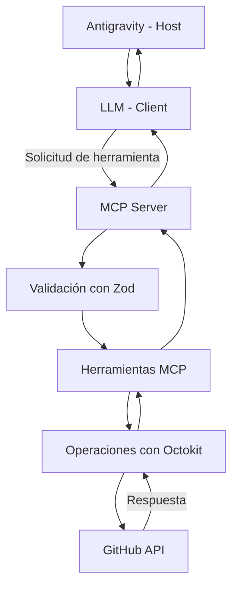

# GitHub AI Agent MCP

Servidor MCP desarrollado con Node.js y TypeScript que permite interactuar con GitHub mediante herramientas de inteligencia artificial y lenguaje natural.

El proyecto utiliza el Model Context Protocol (MCP) para conectar un agente de IA con la API de GitHub mediante Octokit.

## 1. Objetivo del proyecto

Facilitar la automatización de tareas habituales de GitHub desde un agente de IA conectado a un servidor MCP.

Con este proyecto es posible:

- Consultar los repositorios de una cuenta de GitHub.
- Consultar incidencias abiertas.
- Crear repositorios.
- Crear incidencias.
- Crear o actualizar archivos mediante commits.

## 2. Tecnologías utilizadas

- Node.js 18 o superior.
- TypeScript.
- Model Context Protocol SDK.
- Octokit REST API.
- Zod para validación de datos.
- Vitest para pruebas automatizadas.
- dotenv para variables de entorno.
- Antigravity como host MCP.

## 3. Arquitectura del proyecto

El sistema está compuesto por los siguientes elementos:



### Flujo de funcionamiento

1. El usuario escribe una solicitud en lenguaje natural en Antigravity.
2. El LLM interpreta la solicitud y selecciona la herramienta adecuada.
3. El servidor MCP recibe los parámetros.
4. Zod valida los datos recibidos.
5. La herramienta ejecuta la operación correspondiente.
6. Octokit se comunica con la API de GitHub.
7. El resultado regresa al agente de IA para presentarlo al usuario.

## 4. Requisitos

Antes de instalar el proyecto se necesita:

- Node.js 18 o superior.
- npm.
- Una cuenta de GitHub.
- Un GitHub Personal Access Token con los permisos necesarios.
- Antigravity u otro host compatible con MCP.

## 5. Instalación

### Paso 1. Clonar el repositorio

```bash
git clone https://github.com/marizapata/github-ai-agent-mcp.git
```

### Paso 2. Entrar en la carpeta

```bash
cd github-ai-agent-mcp
```

### Paso 3. Instalar las dependencias

```bash
npm install
```

### Paso 4. Configurar las variables de entorno

Copiar el archivo de ejemplo:

En Windows PowerShell:

```powershell
Copy-Item .env.example .env
```

Abrir el archivo `.env` y configurar:

```env
GITHUB_TOKEN=tu_token_personal_de_github
```

El token debe ser personal y válido.

**Importante:** nunca compartir el token ni subir el archivo `.env` al repositorio.

### Paso 5. Compilar TypeScript

```bash
npm run build
```

Este comando compila el código TypeScript y genera los archivos JavaScript dentro de `dist/`.

## 6. Configuración del GitHub Personal Access Token

Para obtener un token:

1. Ingresar a GitHub.
2. Abrir Settings.
3. Entrar en Developer settings.
4. Seleccionar Personal access tokens.
5. Seleccionar Tokens (classic), para seguir la configuración de scopes de la consigna.
6. Seleccionar Generate new token (classic).
7. Asignar un nombre y una fecha de expiración.
8. Seleccionar los permisos necesarios.
9. Generar el token y copiarlo.
10. Guardarlo en el archivo `.env` mediante la variable `GITHUB_TOKEN`.

La guía del proyecto menciona los siguientes scopes clásicos:

- `repo`: acceso a repositorios y operaciones sobre ellos.
- `user`: acceso a información del usuario autenticado.
- `admin:org`: administración de organizaciones.

El conjunto de herramientas actual no implementa operaciones administrativas de organizaciones, por lo que `admin:org` no es necesario para las seis herramientas actuales, salvo que sea requerido expresamente para la configuración académica.

GitHub recomienda utilizar tokens de acceso detallado y conceder únicamente los permisos necesarios. Si se utiliza uno de estos tokens, deben configurarse los permisos compatibles con cada operación.

Documentación oficial:
https://docs.github.com/es/authentication/keeping-your-account-and-data-secure/managing-your-personal-access-tokens

## 7. Herramientas MCP disponibles

El servidor dispone de seis herramientas.

### 7.1 hello_world

**Descripción:** devuelve un saludo desde el servidor MCP.

**Parámetros:** ninguno.

**Ejemplo de prompt:**

"Salúdame desde el servidor MCP de GitHub."

### 7.2 list_repositories

**Descripción:** lista los repositorios del usuario autenticado en GitHub.

**Parámetros:** ninguno.

**Ejemplo de prompt:**

"Muéstrame los repositorios de mi cuenta de GitHub."

### 7.3 list_issues

**Descripción:** lista las incidencias abiertas de un repositorio específico. Excluye los Pull Requests.

**Parámetros:**

| Parámetro | Tipo | Obligatorio |
|---|---|---|
| owner | string | Sí |
| repo | string | Sí |

**Ejemplo de prompt:**

"Muéstrame las incidencias abiertas del repositorio github-ai-agent-mcp de marizapata."

### 7.4 create_repository

**Descripción:** crea un nuevo repositorio en la cuenta autenticada de GitHub.

**Parámetros:**

| Parámetro | Tipo | Obligatorio |
|---|---|---|
| name | string | Sí |
| description | string | No |

El nombre debe tener entre 3 y 100 caracteres y permitir únicamente letras, números y guiones según las reglas del schema.

La visibilidad no es un parámetro configurable desde esta herramienta.

**Ejemplo de prompt:**

"Crea un repositorio llamado proyecto-prueba-mcp con la descripción Proyecto de automatización con inteligencia artificial."

### 7.5 create_issue

**Descripción:** crea una incidencia en un repositorio de GitHub.

**Parámetros:**

| Parámetro | Tipo | Obligatorio |
|---|---|---|
| owner | string | Sí |
| repo | string | Sí |
| title | string | Sí |
| body | string | No |

**Ejemplo de prompt:**

"Crea una incidencia en el repositorio proyecto-prueba-mcp del usuario marizapata con el título Error de configuración y la descripción Revisar la configuración del servidor MCP."

### 7.6 create_commit

**Descripción:** crea un commit para agregar o modificar un archivo en un repositorio de GitHub.

**Parámetros:**

| Parámetro | Tipo | Obligatorio |
|---|---|---|
| owner | string | Sí |
| repo | string | Sí |
| message | string | Sí |
| path | string | Sí |
| content | string | Sí |

La herramienta consulta si el archivo existe:

- Si no existe, lo crea.
- Si existe, obtiene su SHA y lo actualiza.

**Ejemplo de prompt:**

"En mi repositorio proyecto-prueba-mcp, crea el archivo docs/ejemplo.txt con el contenido Hola desde mi servidor MCP y registra el cambio con el mensaje Crear archivo de ejemplo."

**Nota:** estas herramientas realizan operaciones reales en GitHub. Verificar el propietario, repositorio y contenido antes de solicitar cambios.

## 8. Configuración en Antigravity

Después de instalar las dependencias y compilar el proyecto:

1. Abrir la configuración MCP de Antigravity.
2. Abrir el archivo `mcp_config.json`.
3. Registrar el servidor en `mcpServers`.
4. Actualizar la ruta `cwd` con la ubicación real de la carpeta del proyecto.

Ejemplo de configuración para Windows:

```json
{
  "mcpServers": {
    "github-ai-agent": {
      "command": "node",
      "args": ["dist/index.js"],
      "cwd": "C:\\Users\\TU_USUARIO\\Desktop\\github-ai-agent-mcp"
    }
  }
}
```

En el entorno utilizado para desarrollar este proyecto, el archivo de configuración se encuentra en:

`C:\Users\TU_USUARIO\.gemini\config\mcp_config.json`

Reemplazar `TU_USUARIO` y la ruta del proyecto por las ubicaciones correspondientes del equipo.

El servidor utiliza el archivo `.env` ubicado en la carpeta configurada mediante `cwd`.

Guardar los cambios y actualizar o reiniciar el servidor MCP en Antigravity.

Una vez conectado, deben aparecer las seis herramientas disponibles.

## 9. Ejecutar el proyecto

### Modo desarrollo

```bash
npm run dev
```

### Compilar el proyecto

```bash
npm run build
```

### Iniciar el servidor compilado

```bash
npm start
```

El servidor utiliza comunicación STDIO para intercambiar mensajes con el host MCP.

## 10. Pruebas automatizadas

El proyecto utiliza Vitest para verificar el comportamiento de los schemas, operaciones y manejo de errores.

Ejecutar todas las pruebas:

```bash
npm test
```

Las pruebas de operaciones utilizan mocks de Octokit para evitar llamadas reales a GitHub.

### Verificaciones realizadas

- Validación de nombres de repositorios.
- Validación de incidencias.
- Listado de repositorios e incidencias.
- Creación de repositorios e incidencias.
- Creación y actualización de archivos.
- Clasificación de errores de validación, autenticación, API y conexión.

El proyecto cuenta con ocho pruebas automatizadas aprobadas.

## 11. Solución de problemas frecuentes

### Error: falta configurar GITHUB_TOKEN

Verificar que exista el archivo `.env` en la raíz del proyecto y que contenga la variable:

```env
GITHUB_TOKEN=tu_token_personal_de_github
```

### Error HTTP 401

El token puede ser incorrecto, haber expirado o no ser válido.

Verificar las credenciales configuradas.

### Error HTTP 403

Puede deberse a permisos insuficientes, límites de solicitudes o restricciones de la organización.

Revisar los permisos del token y las condiciones de acceso.

### Error HTTP 404

Verificar que el propietario y el nombre del repositorio sean correctos y que el token tenga acceso al recurso.

### El servidor no aparece en Antigravity

Comprobar:

- Que el proyecto esté compilado mediante `npm run build`.
- Que la ruta `cwd` sea correcta.
- Que exista el archivo `.env`.
- Que la configuración JSON sea válida.
- Que el servidor MCP se haya actualizado o reiniciado.

### Error de conexión con GitHub

Verificar la conexión a internet y volver a intentar la operación.

## 12. Seguridad

- Las credenciales se administran mediante variables de entorno.
- El archivo `.env` está excluido del control de versiones.
- El archivo `.env.example` contiene únicamente valores ilustrativos.
- Los mensajes de log sanitizan patrones comunes de tokens para evitar exponer credenciales.
- No se deben compartir tokens personales ni incluirlos en el código fuente.

## 13. Licencia

Este proyecto declara la licencia ISC en su archivo `package.json`.

## 14. Repositorio

GitHub:

https://github.com/marizapata/github-ai-agent-mcp
